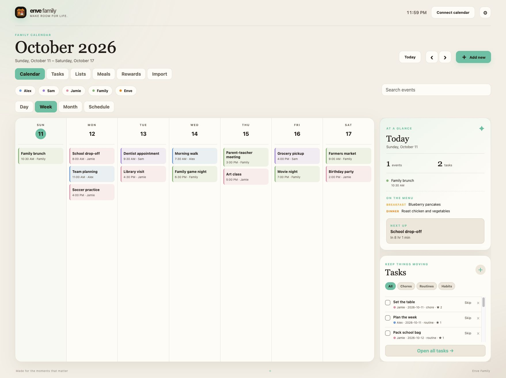
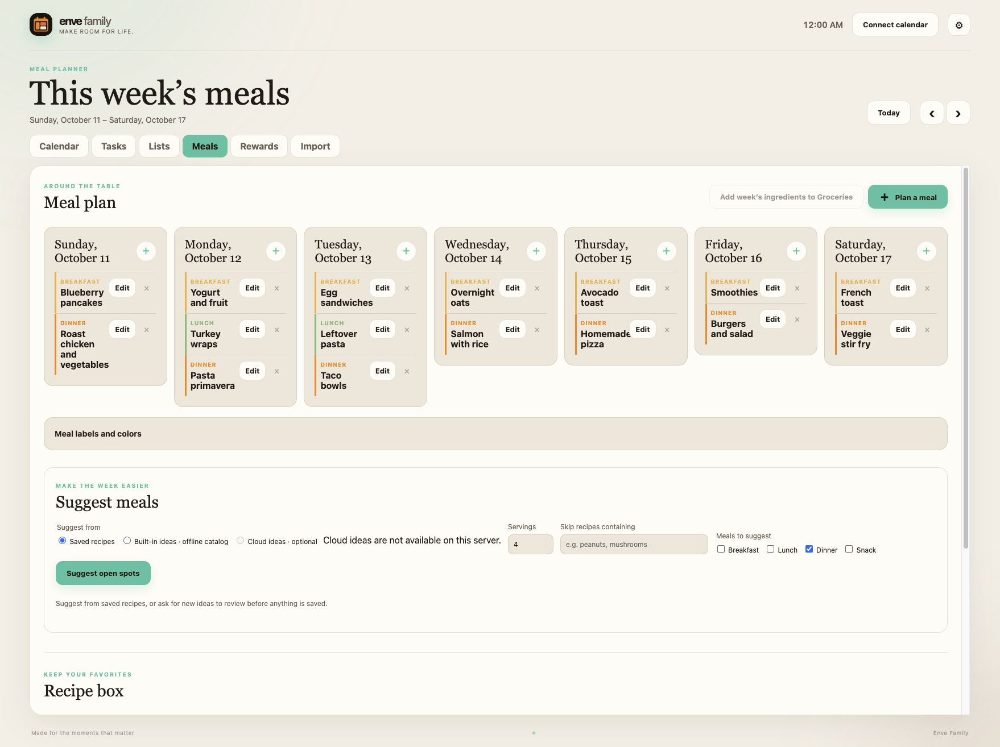
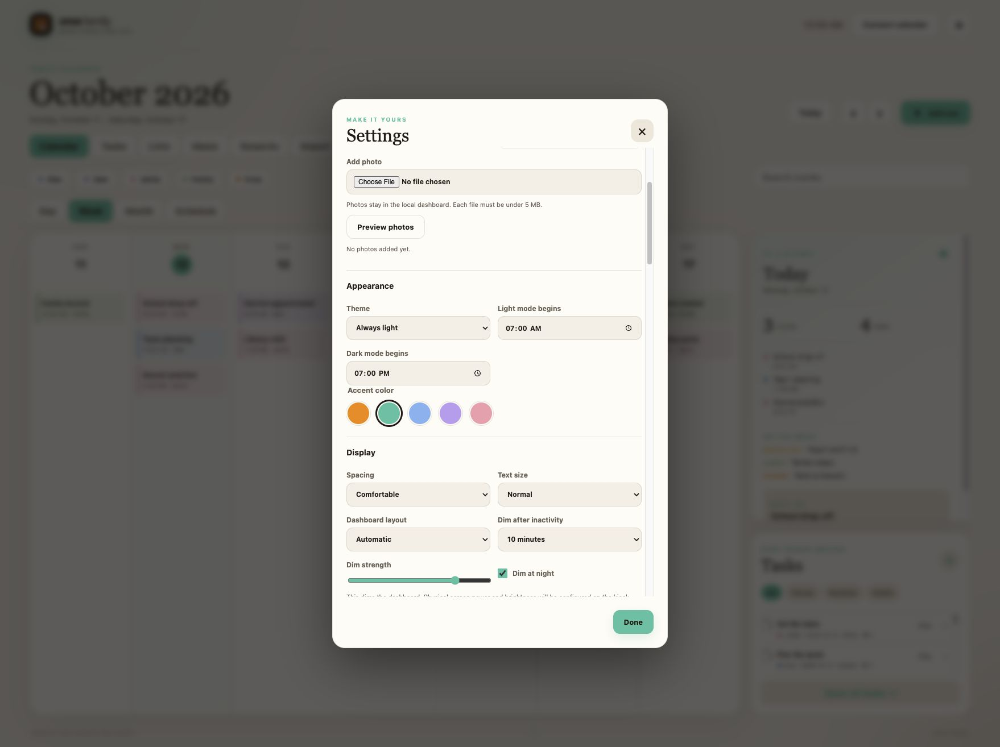

# Enve Family Dashboard


Part of the Enve family of apps. Designed for a shared wall display and the phones in your household.

A self-hosted, touch-friendly family calendar with day, week, month, and schedule views; repeating local events; timed reminders; rotating chores, routines, and habits; shared lists; recipe-based meal suggestions; rewards; weather; local photos; import drafts; backups; and an optional parent edit PIN. Google, iCloud, and Outlook Calendar connections are available. The Raspberry Pi Zero 2 W target can run the server and display together, using either the complete WebKit interface or a lighter native interface. The Mac and Unraid remain server options.

## Screenshots

These screenshots use an invented household and a disposable database. No connected accounts or private calendar data appear in them.

| Calendar | Meals | Appearance |
| --- | --- | --- |
|  |  |  |

The [Tasks page](docs/screenshots/tasks.jpg) gives chores, routines, and habits their own space. The dashboard adapts to an [iPhone-sized browser](docs/screenshots/phone-calendar.jpg). The [native iPhone app](docs/screenshots/iphone-app.jpg) uses the same household data and accent.

## License

Enve Family's original source is licensed under the [GNU Affero General Public License v3.0 only](LICENSE.md) (`AGPL-3.0-only`), the same license used by the Enve Book Player apps. Dependencies retain their own licenses; see [third-party notices](THIRD_PARTY_NOTICES.md).

## Run on the Mac

Requires Node.js 22.13 or newer. On macOS, image and PDF text recognition uses Apple's Vision framework. On Linux, install `poppler-utils`, `tesseract-ocr`, and `webp` for the same feature. Install Node dependencies once.

```sh
npm install
npm start
```

Run these commands from the cloned repository root. Open [http://localhost:4317](http://localhost:4317). The SQLite database is created in `data/`, which is excluded from Git. Stop the server with Control-C. Run `npm test` for the API checks and `npm run format:check` for source formatting.

## Put it on a phone

The dashboard can open from a home-screen icon with its own app window. The same events, tasks, lists, meals, and rewards are available on the phone. The Mac or home server must stay running, and the phone must be on the same home network.

1. On a new installation, complete the first-run setup on the server device. Choose no password, one household password or PIN, or separate adult sign-ins, then add people and their colors. The wall display opens automatically. Settings → People explains each option and lets the owner change it later. No password lets anyone who can reach the server view and change household information, so use it only on a trusted private network.
2. Set `HOST=0.0.0.0` in your private `.env` file and run `npm run start:configured`. On the phone, open `http://<server-LAN-address>:4317`. It opens directly if you chose no password; otherwise sign in with the household or adult password or PIN. Do not use `localhost` on the phone; that points to the phone itself.
3. On iPhone, open the page in Safari and choose **Share → Add to Home Screen → Open as Web App**. On Android, use the browser menu’s **Add to Home screen** or **Install app** option when offered.

The home-screen app keeps using the same server. Changes to local items notify other open devices immediately. It keeps the last loaded view for disconnections and can queue new local events, tasks, list items, and meals when it knows it is offline. Edits and connected-calendar changes still need the server. On localhost or HTTPS, its service worker also keeps the app shell available for a cold reload. The native iPhone app is in [ios/](ios/) and connects to the same server. It is not yet distributed through the App Store. See [DEPLOYMENT.md](DEPLOYMENT.md) for the one-Pi target and private access away from home.

Settings let you rename people, choose their colors, choose the dashboard accent, set light and dark start times, select text size and display density, choose a portrait or landscape layout, and set idle dim and sleep schedules. Use **Preview dim screen** to check it immediately. The dim screen wakes on touch, click, or keypress. Tapping the sleeping screen wakes it for 15 minutes. Night dim reduces the dashboard's brightness. Browser software cannot reliably change a monitor's physical backlight; that part depends on the final kiosk hardware.

Local events can repeat daily, weekly, monthly, or yearly. Choose **Only this event** or **Entire series** when editing or deleting a repeating event. Timed events and tasks can show a reminder with an optional chime while the dashboard stays open. Set a city in Settings for current weather and a five-day forecast; this requires an internet connection. Add photos in Settings to show a rotating idle gallery. The sleep schedule takes precedence over photos.

Calendar search finds saved local events and connected events beyond the dates currently displayed. Google uses text search; Outlook, iCloud, and subscribed calendars are searched within a reported date range. The results show provider failures when a calendar cannot be searched. Choose a result to jump to its day.

The **Lists** tab has groceries and custom lists with sections, sorting, and checkoff. The **Meals** tab plans breakfasts, lunches, dinners, and snacks, with editable labels and colors. Meals can link several recipes, repeat daily, weekly, or monthly, and be edited or deleted for one date or the series. The recipe box stores photos, servings, ingredients, and directions; choosing another serving size scales numeric ingredient amounts. Meal suggestions can use saved recipes or a built-in catalog without an external service. Set `OPENAI_API_KEY` on the server to offer optional cloud ideas; selected dates, meal types, servings, and exclusions are sent to OpenAI, and all ideas remain editable drafts until you confirm them. **Add week's ingredients to Groceries** merges compatible quantities from planned meals and does not transfer the same meal twice. The **Rewards** tab tracks stars earned from completed tasks, shows progress toward per-person goals, and lets each person redeem household rewards. Undoing a completed task removes its stars while they are unspent. Repeating chores can rotate among named household members; completing or skipping a turn assigns the next person. Completing a starred chore shows a brief celebration.

The **Import** tab accepts pasted text or email, `.ics` calendars, images, and PDFs. It extracts editable drafts for events, tasks, lists, or recipes. Review each draft and save it separately; extraction can misread dates or ingredients. Images and PDFs use recognition on the server. Dictation appears when the browser offers speech recognition and may use the browser provider’s speech service. You can paste a transcript instead. Settings → **Calendar URLs** accepts public HTTPS iCalendar feeds as read-only subscriptions. A service must provide a compatible feed URL.

Settings → **Backup** downloads a JSON copy of local events, tasks, lists, meals, rewards, settings, and photos. Calendar credentials and the parent PIN are excluded. Restoring replaces local household data and keeps connected calendar accounts. Settings → **Parent edit PIN** optionally protects changes from every device; people can still complete or skip existing chores. An unlock lasts 15 minutes. Keep backup files private because they contain household data.

## Connect Google Calendar

1. In Google Cloud, enable the Google Calendar API and configure an OAuth consent screen for your household accounts.
2. Create an **OAuth web application** with the exact redirect URI `http://localhost:4317/api/google/callback`.
3. Copy `.env.example` to `.env` and set `GOOGLE_CLIENT_ID` and `GOOGLE_CLIENT_SECRET` there. Keep `.env` private.
4. Run `npm run start:configured`. Open the dashboard at **localhost**, then use Settings → Google Calendar to connect each account and enable its calendars.

The app requests Calendar read access and event write access. It stores refresh tokens in the private local SQLite database so events stay available after the initial connection. Google calendars load live; if Google is unavailable, local events and tasks still work and the dashboard shows a connection error. Google calendar and event colors are shown when available. Events added to Google calendars are stored there; local events are stored only in this app. Writable Google events can be edited or deleted from the dashboard. An account can be disconnected in Settings.

For the initial localhost setup, connect the Google account in a browser on the server device. The native Pi display reads the same calendar data from the server.

When moving the server to an always-on host, set `GOOGLE_REDIRECT_URI` to the exact HTTPS callback URL that browsers can reach, and add that URL to the same OAuth client's authorized redirect URIs in Google Cloud. Leave it unset for the Mac localhost test.

## Connect Outlook Calendar

1. Register a Microsoft Entra web app for personal Microsoft accounts and work or school accounts. Add delegated `User.Read` and `Calendars.Read` permissions.
2. Add the exact web redirect URI `http://localhost:4317/api/outlook/callback` and create a client secret.
3. Set `OUTLOOK_CLIENT_ID` and `OUTLOOK_CLIENT_SECRET` in the private `.env` file, then run `npm run start:configured`.
4. Open the dashboard at **localhost** and use Settings → Outlook Calendar to connect each account and choose its calendars.

Outlook events are read only. Live connection requires a Microsoft account and a redirect URI that matches the server address. For the localhost configuration above, complete connection in the browser on the server computer.

## Connect iCloud Calendar

In Settings → iCloud Calendar, enter the Apple Account email and an [app-specific password](https://support.apple.com/en-us/102654) in a browser on the server device at **localhost**. Do not enter the main Apple Account password. The app discovers the account's CalDAV calendars and lets you choose which appear. A single, non-recurring iCloud event without invitees can be created, edited, or deleted from the dashboard. Use Apple Calendar for recurring events and invitations.

The app-specific password is stored in the server's private local SQLite database. Disconnecting the account removes its saved password from the database; you can revoke the password in Apple Account settings. A live account is needed to verify synchronization on a new installation.

## Raspberry Pi Zero 2 W display

Build the native display from [pi-native/](pi-native/) and run it alongside the Node server on Raspberry Pi OS Lite. The display connects to `http://127.0.0.1:4317`; phones connect to the Pi's LAN address. The native Pi display does not use Chromium or a desktop environment. Confirm Pi performance, touch input, and backlight control with the actual display hardware. See [DEPLOYMENT.md](DEPLOYMENT.md).

The dashboard is intended for one household. It supports no password, a shared sign-in, or separate adult accounts; the household owner manages accounts when sign-ins are on. The Tasks tab shows all tasks with status, person, and type filters; the calendar retains its short task list. Offline edits to connected calendar events are not implemented. The full-feature Pi kiosk runs the complete interface with WPE WebKit and an on-screen keyboard. Measure its memory use and responsiveness on the target Pi Zero 2 W and display before relying on it. The native display supports an optional Linux backlight brightness path; actual screen power control depends on the touchscreen hardware.

## Connect other programs

The owner can create a connection key in **Settings → Connected programs**. Choose **View only** or **View and add or edit**. Copy the key when it appears; Enve stores only its hash and cannot show it again. Remove the connection in Settings to revoke the key immediately. Give each program its own key.

Programs send `Authorization: Bearer <key>` to `/api/integrations/v1`. Available reads are `GET /profiles`, `/tasks`, `/lists`, `/events?from=YYYY-MM-DD&to=YYYY-MM-DD`, and `/meals?from=YYYY-MM-DD&to=YYYY-MM-DD`. Date ranges are limited to 43 days. Reads return local Enve data; connected Google, Outlook, and iCloud calendars are not exposed through this API.

A key with edit access can `POST` to `/tasks`, `/events`, `/list-items`, `/lists`, `/meals`, `/rewards`, and `/goals`. It can `PATCH` existing `/tasks/{id}`, `/events/{id}`, `/list-items/{id}`, and `/meals/{id}`. Payloads use the same fields as the dashboard: for example, a task accepts `title`, `profileId`, `dueDate`, `dueTime`, `taskType`, and `repeatRule`; a local event accepts `title`, `profileId`, `start`, `end`, `allDay`, and `notes`. The read routes supply profile and item IDs. This API cannot manage users, calendar accounts, settings, connection keys, or deletions.

Example, after setting `ENVE_FAMILY_KEY` in the calling program's private environment:

```sh
curl -H "Authorization: Bearer $ENVE_FAMILY_KEY" http://127.0.0.1:4317/api/integrations/v1/profiles
```

Keep keys out of URLs and logs. The Pi's plain HTTP LAN address does not encrypt requests; use a private encrypted tunnel or HTTPS proxy for access outside the Pi. Do not expose port 4317 directly to the public internet. An MCP adapter can use these routes for ChatGPT or other AI tools without changing Enve's database.
